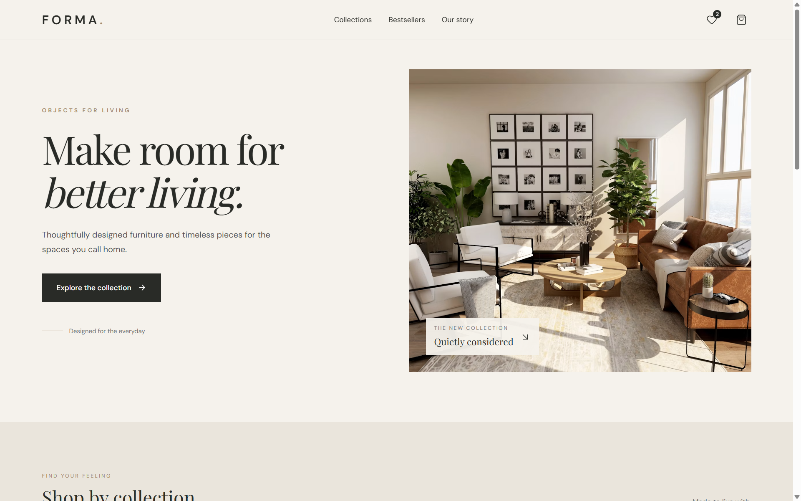
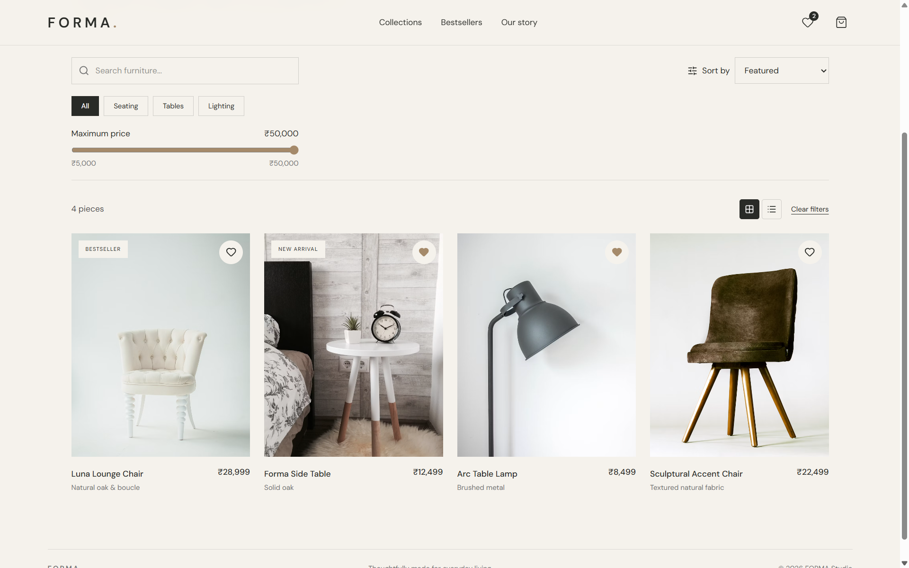
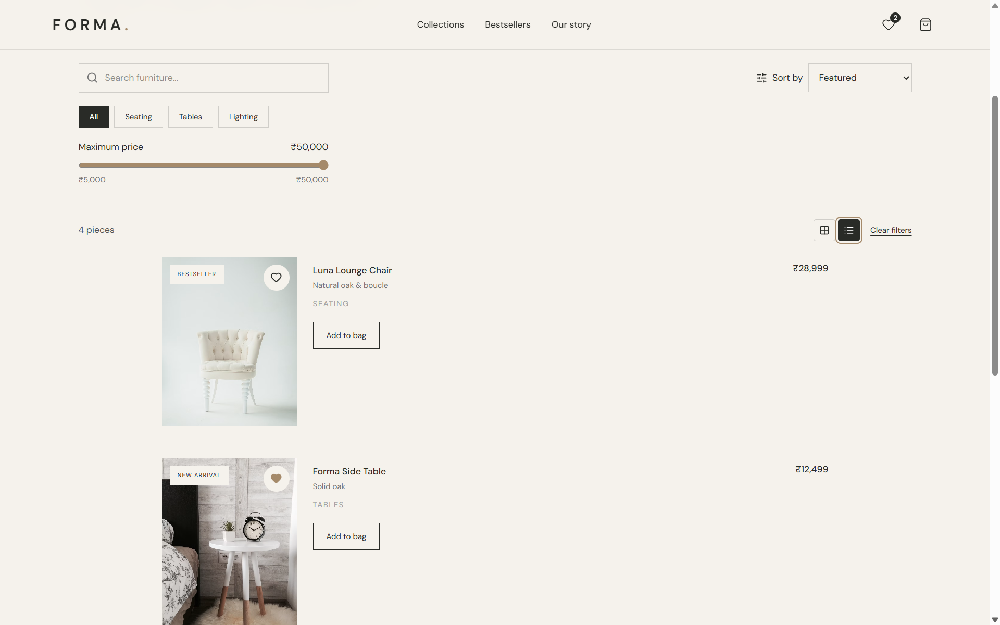
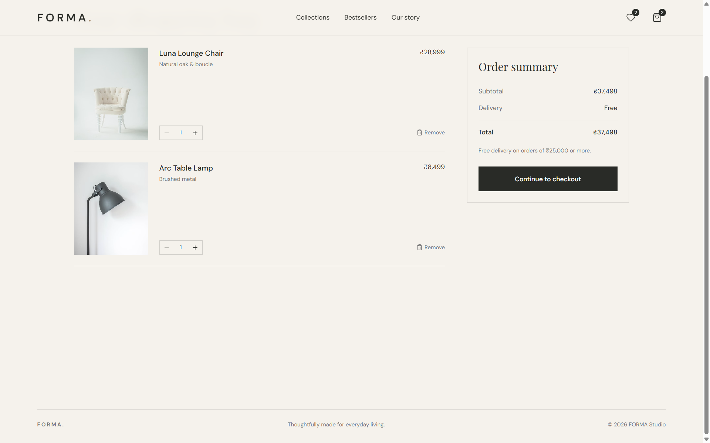
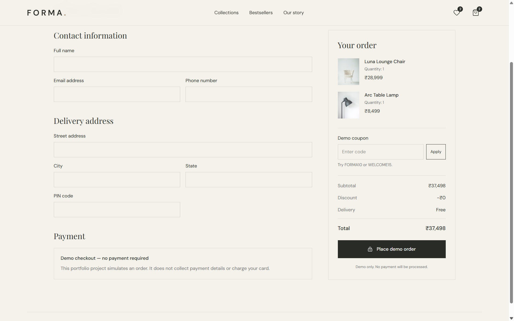

# FORMA — Premium E-commerce Storefront

A responsive furniture and home-decor storefront built with React. FORMA features an editorial, minimal design with a warm cream palette, product browsing, wishlist and cart functionality, and a simulated checkout flow.

**Live demo:** [https://forma-store-6sdl.vercel.app/](https://forma-store-6sdl.vercel.app/)

**Source code:** [https://github.com/Rameshkumar254848/forma-store](https://github.com/Rameshkumar254848/forma-store)

## Screenshots

### Homepage



### Shop — Grid View



### Shop — List View



### Shopping Cart



### Checkout



## Features

- Responsive storefront layout for desktop and mobile
- Product collection with search, category and price filters, and sorting
- Grid and list product views, with the selected view saved in local storage
- Product detail pages
- Shopping cart with quantity updates and item removal
- Wishlist with add/remove actions
- Cart and wishlist persistence using Redux state and local storage
- Checkout form with field-level validation
- Demo coupon codes: `FORMA10` and `WELCOME15`
- Simulated order confirmation; no payment is collected or processed
- Reusable React hooks and utility functions
- React Router navigation and custom page titles

## Tech Stack

- React
- Vite
- Tailwind CSS
- React Router
- Redux Toolkit and React Redux
- Lucide React
- JavaScript
- Vercel for deployment

## Run Locally

### Prerequisites

- Node.js (use a current supported LTS release)
- npm

### Installation

1. Clone the repository:

   ```bash
   git clone https://github.com/Rameshkumar254848/forma-store.git
   ```

2. Move into the project directory:

   ```bash
   cd forma-store
   ```

3. Install dependencies:

   ```bash
   npm install
   ```

4. Start the development server:

   ```bash
   npm run dev
   ```

5. Open the local URL printed in your terminal.

## Production Build

Create a production build:

```bash
npm run build
```

Preview the production build locally:

```bash
npm run preview
```

## Project Structure

```text
src/
├── app/
│   ├── persistence.js
│   └── store.js
├── components/
│   ├── CheckoutField.jsx
│   ├── ImageWithFallback.jsx
│   ├── ProductCard.jsx
│   └── ShopFilters.jsx
├── data/
│   └── products.js
├── features/
│   ├── cart/
│   │   └── cartSlice.js
│   └── wishlist/
│       └── wishlistSlice.js
├── hooks/
│   ├── useClickOutside.js
│   ├── useDebounce.js
│   ├── useDocumentTitle.js
│   └── useLocalStorage.js
├── pages/
│   ├── Cart.jsx
│   ├── OrderSuccess.jsx
│   ├── ProductDetails.jsx
│   ├── Shop.jsx
│   ├── Wishlist.jsx
│   └── Checkout.jsx
└── utils/
    ├── formatCurrency.js
    └── validateCheckout.js
```

## Notes

FORMA is a frontend portfolio project. Checkout is simulated for demonstration purposes and does not process real payments. Product data is sample data.

## Author

**Ramesh Kumar**

- GitHub: [Rameshkumar254848](https://github.com/Rameshkumar254848)
- Live project: [FORMA — Premium E-commerce Storefront](https://forma-store-6sdl.vercel.app/)